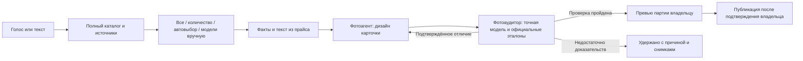

# Товарный автопилот

Ветка разработки: `codex/photo-audit-agent`.

Целевой путь одной карточки:

## Как пользоваться

Открыть «Оркестратор», вызвать `/menu`. Кнопка «📚 Каталоги и товары» показывает
подключённые источники и объясняет способы выбора. Команды можно писать или диктовать:

- «Холодильники» — предложит все модели, количество, автоматический или ручной выбор.
- «Все холодильники Beko» — все доступные модели этого бренда.
- «Выбери автоматически 7 телевизоров Xiaomi» — ровно до семи доступных Xiaomi,
  без добора другими брендами при нехватке.
- «Первые 3 холодильника» — первые три по порядку каталога.
- «Хочу выбрать холодильники сам» — список с отметками и страницами.
- «Покажи все модели» после разговора о холодильниках — просмотр той же категории;
  сам просмотр генерацию не запускает.

Авторежим чередует бренды и поставщиков в устойчивом порядке. Это разнообразие
выборки; обещания выбирать по прибыли или популярности без таких данных нет.
Указанное владельцем число сохраняется. Если товаров меньше, возвращается фактически
принятое количество. Исчезнувшая модель не заменяется другой без ведома владельца.

Выбор хранится в базе, имеет срок действия и версию кнопок. Повторное нажатие не
создаёт вторую партию. Перед запуском ключи моделей заново проверяются по действующим
остаткам и уже занятым товарам. При неизвестном результате внешней постановки повтор
удерживается для разбора, чтобы не расходовать генерации повторно.

## Источники и роли

`orchestrator_bot.catalog_cli` использует загрузчик и хранилище content-factory,
но находится в этом репозитории. Исходники content-factory для полного справочника
и ручного выбора не переписываются. Отдельный минимальный патч
`integrations/cf-photo-audit-hold.patch` останавливает повтор после окончательного
удержания фотоаудитором; сетевые сбои сохраняют обычный ограниченный повтор.
Список брендов передаётся полностью; отсутствие
слова в подсказке модели не является доказательством отсутствия товара.

Менеджер каталога отвечает за фильтры и количество. Контент-менеджер берёт товарные
факты из подключённых прайсов. Дизайнер — существующий фотоагент, собирающий
товарный макет вокруг реальной фотографии. Контролёр —
`@foto_auditor_bot`: поиск производителя, подтверждение точной модели на странице,
скачивание реальных фото и визуальное сравнение. Тексты страниц и изображений не
могут менять правила проверки.

Сначала официальный производитель; суммарно до пяти источников. Логотип, изображение
похожей серии и позиция из рекомендаций не подтверждают соответствие товара.
Если сайт производителя недоступен, резервная проверка требует согласованности
минимум трёх независимых каталогов точной модели по каждому видимому признаку
в двух проходах. Отчёт явно указывает резервные источники; противоречия не одобряются.
После подтверждённого отличия дизайнер получает конкретные замечания; максимум два
исправления. Товарные карточки собираются как HTML-макет с неизменённым исходным
фото товара. Если детали исходника не подтверждаются, а официальный эталон
надёжно связан с точной моделью, пересборка использует этот скачанный эталон.
Это разрешение на новую компоновку, а не одобрение изображения или публикации.
Каждый новый файл проверяется заново. Нет надёжного эталона,
модель не определена, источники недоступны или исчерпан лимит — карточка удерживается.
После общего лимита в двадцать минут дорожка освобождается; проверка уже сохранённого
фото может продолжиться в службе аудитора. Новая ревизия не продлевает этот лимит.
Точные сантиметры по фотографии без масштаба не измеряются.

Для автоматического одобрения нужны два отдельных визуальных прохода. Второй
дополнительно проверяет кнопки, дисплеи, барабаны, дверные стыки и комплектующие.
Ранее подтверждённое замечание по тем же байтам изображения и официального
эталона не исчезает от повторной оптимистичной оценки. Разрешение выгрузки
проверяется и по подписи файла, и по текущему последнему решению в базе.

Проверка стоит перед outbox и перед сетевой выгрузкой, включая research и повторную
отправку. Разрешение связано с заданием и SHA-256 файла. Старый outbox без подтверждения
сохраняется отдельно для разбора. Редакционные сцены и ритуальные композиции не
выдаются за прошедшие товарный аудит. Промежуточные замечания идут генератору;
владельцу отправляются итоговые результаты.

При лимите ChatGPT снимок ожидает провайдера, а не оплачивается заново. После
восстановления последнее решение возобновляет то же неудачное задание. Квитанция
в базе защищает от повторной доставки ответа. Сохранённые снимки результата и
исходника позволяют продолжить работу после отключения света, в том числе когда
сервер уже удалил входной файл. Неизвестный результат начатой генерации требует
разбора, а не слепого повтора. Реальная ошибка загрузки источника передаётся поиску:
до трёх попыток с выбором другого источника и без замены точной модели.

Поиск товара работает через подключённый ChatGPT без браузерного поля ввода.
Скачанные источники и факты сохраняются с хешами, факты проверяются по текстам.
Список товаров передаётся как JSON: запятые в старых ключах поставщиков не
разбивают одну позицию на несколько. Согласование и публикация прежней партии
не засчитываются в новый запуск. Позднее решение аудитора вновь открывает
партию, завершившуюся с ошибками; отмена владельцем сохраняет силу.

## Пробная партия

Для калибровки подготовлены десять различных реальных позиций: шесть холодильников
и четыре стиральные машины. Состав: `runs/2026-10-23/autopilot/sample-manifest.json`.
Флаг публикации выключен. Цель — сопоставить выводы аудитора с оценкой владельца.
Подготовленный состав не означает, что генерация уже выполнена.
Список для просмотра — [autopilot-test-batch.md](autopilot-test-batch.md).
Под отчётом контроля владелец отмечает соответствие товара либо расхождение.
Эта оценка используется для разбора качества контроля и не меняет разрешение на публикацию.

`python tools/autopilot_trial.py` показывает план без постановки заданий.
После согласованного подключения `--start` однократно ставит выбранные десять
позиций, `--report` читает их состояние. Повторный запуск использует ту же метку
партии; прерванная неопределённая постановка требует разбора вместо повторной оплаты.

Генератор сохраняет свои файлы в собственном output. Аудитор хранит точные снимки,
официальные эталоны, хеши, отчёт и лист сравнения в `runs/photo-auditor/<id>/`.
Состояние операций — в SQLite; токены — отдельно в зашифрованном хранилище,
в отчёты и Git они не попадают.
