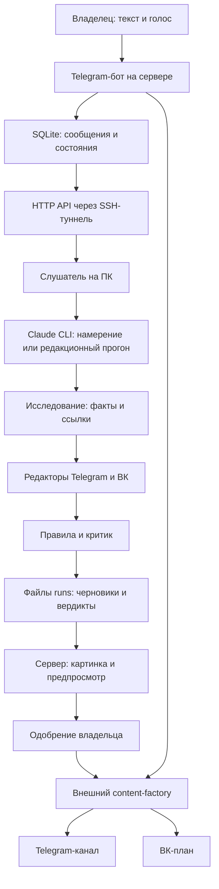

# Обзор проекта и предложения по развитию

Дата: 22 октября 2026 года. Исполнитель: Codex.

Репозиторий: https://github.com/flycited2-dotcom/all_content_autopilot

Рабочая папка: `C:\Users\TLT-1\Documents\GitHub\Agents_MY`.
Ветка для дальнейшей работы: `codex/project-review-content-sources`.
Исходный коммит: `7d1a03a3c59f160ec258e4232c388fda14861146`.
На момент проверки локальная ветка `master` и GitHub `main` указывали на этот коммит;
локальных изменений перед началом работы не было. Открытых issues и PR на GitHub не найдено.

## Вывод

Проект уже содержит Python-оркестратор с Telegram-интерфейсом, очередью SQLite,
голосовым вводом, редакционным конвейером на ПК, согласованием постов и товарных партий.
Сохранять это разделение разумно: сначала укрепить восстановление задач и управление
версиями, затем подключать новые источники и строить календарь на достоверных статусах.

В рамках этого обзора исходный код и работающие сервисы не изменялись. Добавлен только
этот документ. Состояние продакшена и фактическая доступность внешних источников не проверялись.

## Что где находится

| Область | Файлы | Назначение |
| --- | --- | --- |
| Telegram-интерфейс | `orchestrator_bot/bot.py`, `telegram_api.py`, `transcribe.py` | Сообщения, голос, команды, кнопки, ответы владельцу |
| Серверная очередь | `orchestrator_bot/store.py`, `api.py` | SQLite, сообщения, действия, партии, черновики; HTTP API на localhost |
| Исполнение команд | `orchestrator_bot/intents.py`, `actions.py` | Разбор намерений, проверка действий, постановка и отмена товарных задач |
| Связь с фабрикой | `orchestrator_bot/factory.py` | Вызовы внешнего `content_factory.agent_cli` |
| Согласование и публикации | `orchestrator_bot/drafts.py`, `feed.py` | Картинка, предпросмотр, кнопка одобрения, партии и отложенный выход |
| Обработка на ПК | `listener/__main__.py`, `brain.py`, `editorial.py`, `morning.py` | Опрос сервера, Claude CLI, редакционные задания и утренний прогон |
| Редакционная логика | `.claude/commands/`, `.claude/agents/` | Исследователь, редакторы, критик, отчёт |
| Правила качества | `rules/`, `tools/check_draft.py` | Длина, стоп-слова, цены, источники и подтверждение чисел |
| Запуск и установка | `scripts/`, `deploy/` | Планировщик Windows, SSH-туннель, systemd |
| История решений | `docs/superpowers/specs/`, `docs/superpowers/plans/` | Архитектура и этапы разработки |

Схема показывает предусмотренные кодом связи. Исправность запущенных экземпляров этих
компонентов из локального репозитория установить нельзя.

## Источники контента: что подтверждено кодом

1. **Редакционные факты:** исследователь использует WebSearch/WebFetch, собирает 3–7
   фактов с прямыми ссылками. Предпочтения заданы общими словами: производители,
   ГОСТ/СП, Росстандарт и профильные издания. Реестра конкретных сайтов, RSS и
   Telegram-каналов в этом репозитории нет.
   Основание: [researcher.md](../../.claude/agents/researcher.md), строки 8–12.
2. **Товарные данные:** загрузчики прайсов и каталогов находятся во внешнем
   `content-factory`. Здесь есть интерфейсы `hint`, `resolve`, `enqueue` и фильтры
   отбора. Основание: [factory.py](../../orchestrator_bot/factory.py), строки 26–68.
3. **Названия каталогов в инструкциях:** `splithub`, `splithome`, `aru`,
   `manual__быттехопт…`. Они участвуют в маршрутизации запросов; это не доказательство
   актуальности и доступности каждого каталога на сервере.
   Основание: [chat-turn.md](../../.claude/commands/chat-turn.md), строка 26.
4. **Автоматический выбор тем:** сезонность, погода Крыма и частые вопросы уже заданы
   в утреннем брифе. Запрет повтора за 14 дней реализован как инструкция агентам.
   Основание: [morning.py](../../listener/morning.py), строки 16–20.
5. **Telegram как поставщик материалов и видеолиния:** описаны в исходной архитектуре,
   но соответствующих сборщиков в текущем коде бота и слушателя нет. Безголовый запуск
   Claude использует `--strict-mcp-config`; наличие MCP в интерактивном чате само по себе
   не подключает его к этому конвейеру.

## Конкретные проблемы до расширения системы

P1 — высокий приоритет: возможны потеря задания или лишняя публикация.
P2 — следующий приоритет: зависание, неполное выполнение или отсутствие управления.
Это результаты локального аудита, а не утверждение о произошедших сбоях продакшена.

### 1. P1: старая отложенная версия может выйти после новой

[store.py](../../orchestrator_bot/store.py), строки 244–250:
`supersede_versions()` не включает статус `scheduled`.
[drafts.py](../../orchestrator_bot/drafts.py), строки 145–149, позднее публикует его.

Сценарий: владелец одобрил первую версию на вечер, затем опубликовал v2. Первая версия
сохраняет `scheduled` и тоже выходит вечером. На временной SQLite с подставным
публикатором получены две публикации: `post-v2`, затем `post`.

Предложение: замещать также отложенные версии; хранить идентификатор материала отдельно
от версии и канала; атомарно определять единственную действующую версию публикации.

### 2. P1: перезапуск во время исполнения может потерять действие

[api.py](../../orchestrator_bot/api.py), строки 24–26: отметка `intent_done` ставится
до выполнения действий. Если процесс остановится до сохранения результата, повтор
считается дубликатом и может закрыть сообщение без исполнения.

Воспроизведение с прерыванием `resolve()` дало на повторе
`duplicate=true, editorial=[]`, хотя действие ещё не выполнялось.

Предложение: отдельные записи действий со статусами, временем начала, числом попыток
и стабильным ключом идемпотентности; подтверждать завершение после получения результата.
При неопределённом результате сначала сверяться с фабрикой.

### 3. P1: одинаковые ID у редакторов двух каналов

[morning-run.md](../../.claude/commands/morning-run.md), строки 21 и 25, допускает
одну тему сразу для TG и ВК и параллельный вызов редакторов.
[tg-editor.md](../../.claude/agents/tg-editor.md), строка 14, и
[vk-editor.md](../../.claude/agents/vk-editor.md), строка 15, задают одинаковый ID из
slug темы и один путь `drafts/<id>.json`. Один редактор может перезаписать второй.
Кроме того, `drafts.id` в SQLite уникален глобально, без даты и канала.

Это подтверждённое противоречие инструкций; историческое возникновение коллизии не проверялось.
Предложение: ID из `run_id + channel + topic + version`, отдельные `material_id` и
`research_id`; обновить также критика и поиск версий, которые сейчас выводят связи из ID.

### 4. P2: после остановки процесса публикация остаётся зависшей

[drafts.py](../../orchestrator_bot/drafts.py), строки 139–142, и
[feed.py](../../orchestrator_bot/feed.py), строки 116–117: статус `publishing`
сохраняется до внешнего вызова. После остановки процесса восстановления этого состояния нет.
Повтор кнопки заблокирован, планировщик такие записи не подхватывает.

Изолированное прерывание вызова публикации подтвердило, что статус остаётся `publishing`.
Предложение: срок выполнения попытки, сверка результата по исходному ключу и восстановление
при старте. Простой сброс в `ready` без сверки может создать повторную публикацию.

### 5. P2: сбой уведомления Telegram останавливает новый черновик

[drafts.py](../../orchestrator_bot/drafts.py), строки 50–62: сначала запись `new`,
потом уведомление, затем заказ изображения. Ошибка `tg.send()` оставляет `new`;
повторная доставка возвращает `new=false`, а обработчик готовности смотрит только `visual`.

Воспроизведение: после восстановления Telegram картинок заказано 0.
Предложение: возобновлять незавершённые шаги; отправлять уведомления через отдельную
очередь, чтобы доступность чата не определяла судьбу задания.

### 6. P2: частично проваленная партия помечается опубликованной

[feed.py](../../orchestrator_bot/feed.py), строки 122–131: любой нормальный ответ
`publish_keys()` переводит всю партию в `published`, даже если ответ содержит `failed`.

Воспроизведение: одна позиция успешна, вторая в `failed`; вся партия становится
`published`, повтор кнопки отвечает, что она уже обработана.
Предложение: сохранять исход каждой позиции и повторять только неудачные;
отображать частичное выполнение отдельно.

### 7. P2: нет штатной отмены отложенного редакционного поста

[drafts.py](../../orchestrator_bot/drafts.py), строки 131–135 и 178–184: после
одобрения будущего поста кнопки очищаются, а `reject()` не принимает `scheduled`.
Товарные партии имеют отдельную отмену, но она не управляет такими черновиками.

Предложение: список запланированных постов с действиями «Снять с публикации» и
«Перенести», с проверкой текущего статуса перед изменением.

## Предложения по источникам и серверной части

**Реестр источников.** После получения списка владельца создать конфигурацию:
тип, URL или внешний ID, рубрика, приоритет, интервал обновления, назначение
(идея / факт / текст для переработки / товарные данные), правила использования.
Первым подключать один выбранный источник и проверять весь путь до предпросмотра.

**Единая запись материала.** Сохранять исходную ссылку, внешний ID, дату публикации,
дату получения, факты, связи с черновиками и результат проверки. Сейчас у факта есть
`id/text/source_url`, а серверная таблица черновиков не хранит полный набор фактов
и вердикт. Эти связи нужны и для перепроверки, и для удобного интерфейса.

**Устойчивые задания.** Разделить обработку действия, генерацию, уведомление и публикацию
на восстанавливаемые шаги. SQLite достаточно для начального объёма; переход к другой
базе не нужен только ради исправления этих проблем. API доски должен читать состояние,
не забирать задания через существующий `/next`.

**Контроль свежести и повторов.** Сохранять использованные материалы и темы с датами;
проверять повтор внешнего ID/URL/хеша в коде, смысловую близость оставлять дополнительной
проверкой. Перед товарной публикацией повторно подтверждать актуальность данных в фабрике.

**Контракты интеграции.** Проверять формат ответов `agent_cli`, фиксировать совместимую
версию интерфейса. Добавить тесты с прерыванием и повтором действий, частичным успехом,
одной темой для двух каналов. Развивать CI, документацию локального запуска и описание
разделения ответственности между этим репозиторием и `content-factory`.

## Предложения по интерфейсу и изображениям

Сейчас интерфейс — Telegram: «Статус», «Сводка», «Мастер задач», «Лента», сообщения
с превью и кнопками. Товарные карточки согласуются ещё и в другом боте/группе;
отдельного web UI, доски стадий и календаря в репозитории нет.

| Представление | Что показывает | Полезные действия |
| --- | --- | --- |
| Сегодня / неделя | Время, канал, тема, партия, версия, статус | Перенести, снять с публикации, открыть превью |
| Рабочая доска | Идеи → исследование → текст → проверка → одобрение → запланировано → опубликовано | Править, отклонить, повторить неудачный шаг |
| Источники | Последнее обновление, число новых материалов, ошибка, возраст данных | Обновить, отключить, открыть исходник |
| Карточка материала | Текст, картинка, источники, вердикт, история версий и действий | Одобрить конкретную версию, сменить изображение |

Практичный первый шаг — «План на неделю» и список отложенных постов в Telegram.
Если нужен обзор на большом экране, следующим шагом можно сделать панель или Telegram
Mini App поверх отдельного API. История статусов и команды останутся на сервере.

Для изображений полезны согласованные стили по рубрикам, форматы под TG/ВК и библиотека
уже одобренных изображений. Текущий `visual_prompt` и команда «Другая картинка» дают
основу. При последующем добавлении анимации/видео использовать предпочтительный Grok media;
генерация в рамках этого обзора не запускалась.

## Предлагаемый порядок работы

1. Исправить проблемы 1–7 и добавить проверки соответствующих сбоев и повторов.
2. Получить лист/бриф владельца и выбрать первый новый источник.
3. Ввести запись материала, реестр источников и один адаптер; довести материал до
   проверенного предпросмотра с прямыми ссылками и понятной свежестью.
4. Добавить недельный план, отмену/перенос и общую ленту карточек.
5. Расширять источники и визуальные стили по результатам реального использования;
   видеолинию проектировать отдельным этапом.

## Что понадобится от владельца

- Обещанный лист или документ: темы, рубрики, структура и примеры желаемых постов.
- Ссылки на новые источники и их приоритет; для каждого — что брать: идеи, факты,
  материал для переработки или товарные данные.
- Каналы назначения, частота, пропорция товарных и экспертных материалов, время выхода.
- Примеры желаемого оформления и предпочтение по управлению: Telegram или отдельная панель.

Пароли и токены для предварительного проектирования не нужны.

## Проверка и пределы обзора

- Прочитаны код основных модулей, настройки безголового запуска, правила, тесты,
  спецификации и планы. Проверены GitHub-ветки, последние коммиты, открытые issues/PR.
- Полный локальный набор: `python -m pytest -q --basetemp=runs_test/codex-review-local-20261022 --tb=short`
  — **150 passed за 18,62 секунды**, Python 3.13. Запуск выполнен с доступом к локальным
  тестовым HTTP-соединениям на `127.0.0.1`.
- Первоначально песочница блокировала временную папку, затем локальные HTTP-соединения
  (`WinError 10013`). После устранения ограничений окружения существующий набор прошёл.
- Пять сценариев восстановления и частичного выполнения из пунктов 1, 2, 4, 5, 6
  дополнительно воспроизведены на временной SQLite и подставных клиентах. Исходные
  тесты этих ошибок не выявляют. Пункты 3 и 7 подтверждены чтением инструкций и кода.
- Не проверялись VPS, реальные публикации, фактическая работа внешнего `content-factory`,
  доступность его каталогов, Claude CLI и реальная генерация изображений.

Документ фиксирует исходное состояние для следующих изменений в отдельной ветке.
